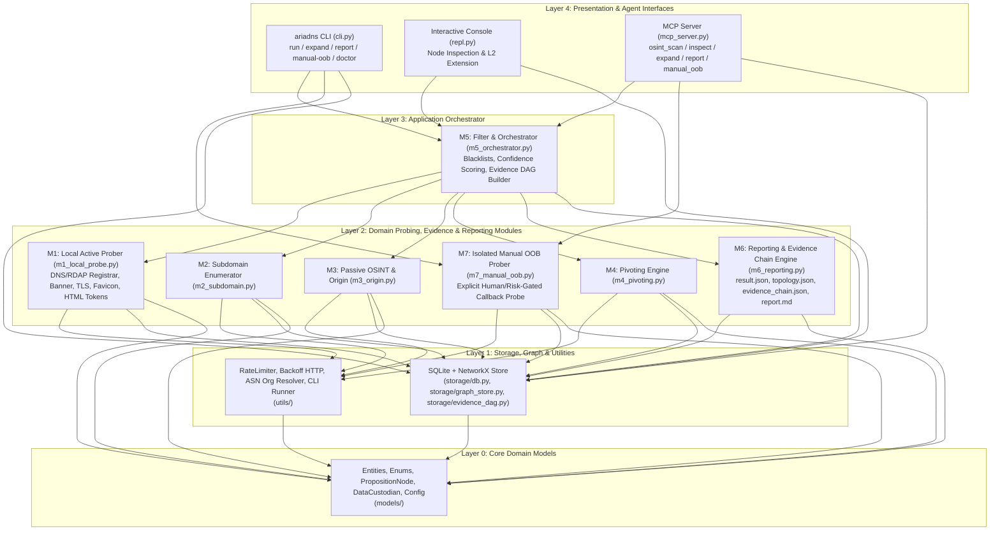
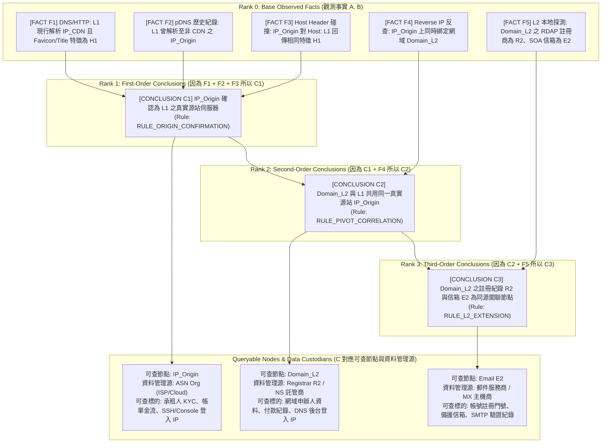

# Ariadns System Architecture (`.mnb/ARCHITECTURE.md`)

## 1. High-Level Topology & Dual-Headed Architecture



---

## 2. Causal Evidence Chain DAG Structure (Rendered in Reports)



---

## 3. Directory Structure & Target Seams

```text
d:\cykuan\geminiCLI\DNSA\
├── pyproject.toml                  # Package metadata (`ariadns`) & entrypoints: `ariadns`, `ariadns-mcp`
├── requirements.txt                # Pinned runtime & test dependencies
├── config.yaml.example             # Template configuration (API keys, blacklists, rate limits)
├── recon.py                        # Root CLI wrapper entrypoint (SRS 5.1 compatibility)
├── src/
│   └── ariadns/
│       ├── models/
│       │   ├── enums.py            # OriginVerificationStatus, ConfidenceLevel, ModuleStatus, NodeType, EdgeType, PropositionKind
│       │   ├── entities.py         # IdentityProfile, Infrastructure, SubdomainRecord, PivotResult, L2Result, DataCustodian, PropositionNode, InvestigationResult
│       │   └── config.py           # AppConfig loader, blacklist defaults, secret masking helper
│       ├── utils/
│       │   ├── rate_limiter.py     # Sliding-window rate limiter & 2s/4s/8s exponential backoff HTTP client
│       │   ├── asn_cdn.py          # Built-in CDN CIDR/ASN matcher + Team Cymru DNS ASN & Org Name resolver
│       │   └── tool_runner.py      # External binary detector (`subfinder`, `httpx`, `nmap`) & `ariadns doctor` checks
│       ├── storage/
│       │   ├── db.py               # SQLite connection, 7-day TTL cache, quota tracker, read-only SQL executor
│       │   ├── graph_store.py      # SQLite `graph_nodes` / `graph_edges` + `networkx` topology
│       │   └── evidence_dag.py     # Chained Propositional Evidence DAG builder, acyclicity verifier & Data Custodian mapper
│       ├── modules/
│       │   ├── m1_local_probe.py   # DNS, RDAP (Registrant + Registrar), Banner, TLS CN/SAN, Favicon SHA-256, HTML Tracking Tokens, Port Scan
│       │   ├── m2_subdomain.py     # crt.sh + HackerTarget + subfinder -> httpx / native prober
│       │   ├── m3_origin.py        # CDN check, VT/OTX pDNS, Host header + Title/TLS/Favicon collision verification
│       │   ├── m4_pivoting.py      # Reverse IP, Reverse MX/NS, Reverse Token/Whois
│       │   ├── m5_orchestrator.py  # Noise filter, Graph weighting, L1->L2 pipeline, EvidenceChainDAG assembly
│       │   ├── m6_reporting.py     # Exports `result.json`, `topology.json`, `evidence_chain.json`, and `report.md` (with Mermaid Evidence DAG & Custodian tables)
│       │   └── m7_manual_oob.py    # Isolated manual-only OOB callback verifier (requires explicit OPSEC risk confirmation)
│       └── interfaces/
│           ├── cli.py              # CLI (`run`, `report`, `manual-oob`, `repl`, `doctor`, `init`)
│           ├── repl.py             # Interactive terminal menu
│           └── mcp_server.py       # FastMCP stdio server (`osint_scan`, `osint_inspect`, `osint_expand`, `osint_report`, `osint_manual_oob`)
└── tests/
    └── ...
```

---

## 4. Strict Import Directionality Rules (Forbidden Cycles)

1. **`ariadns.models`** (Layer 0): Imports Python standard library only.
2. **`ariadns.utils` & `ariadns.storage`** (Layer 1): Imports `ariadns.models` and third-party infra libraries (`dnspython`, `httpx`, `networkx`, `yaml`, `sqlite3`).
3. **`ariadns.modules.m1_*` .. `m4_*`, `m6_*`, `m7_*`** (Layer 2): Imports `ariadns.models`, `ariadns.utils`, `ariadns.storage`. Never imports `m5_orchestrator` or `ariadns.interfaces`.
4. **`ariadns.modules.m5_orchestrator`** (Layer 3): Coordinates `m1`..`m4`, `m6`, `storage`, `utils`, `models`. Never imports `m7_manual_oob` into automatic runs, and never imports `ariadns.interfaces`.
5. **`ariadns.interfaces.*` & `recon.py`** (Layer 4): Imports `ariadns.modules.*`, `ariadns.storage.*`, `ariadns.utils.*`, `ariadns.models.*`.
