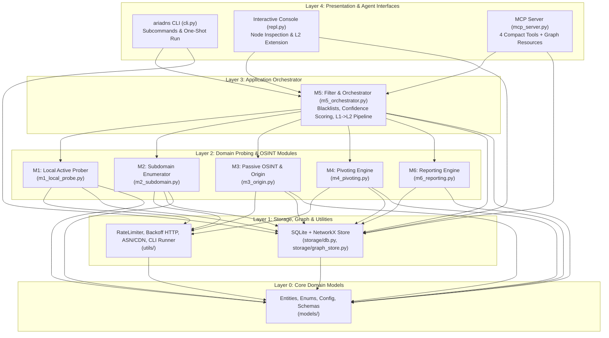

# Ariadns System Architecture (`.mnb/ARCHITECTURE.md`)

## 1. High-Level Topology & Dual-Headed Architecture



---

## 2. Directory Structure & Target Seams

```text
d:\cykuan\geminiCLI\DNSA\
├── pyproject.toml                  # Package metadata (`ariadns`) & entrypoints: `ariadns`, `ariadns-mcp`
├── requirements.txt                # Pinned runtime & test dependencies
├── config.yaml.example             # Template configuration (API keys, blacklists, rate limits)
├── recon.py                        # Root CLI wrapper entrypoint (SRS 5.1 compatibility)
├── scripts/
│   ├── install_tools.sh            # Linux / macOS / WSL external CLI installer
│   └── install_tools.ps1           # Windows (Winget / Scoop / Go) external CLI installer
├── src/
│   └── ariadns/
│       ├── __init__.py
│       ├── models/
│       │   ├── __init__.py
│       │   ├── enums.py            # OriginVerificationStatus, ConfidenceLevel, ModuleStatus, NodeType, EdgeType
│       │   ├── entities.py         # IdentityProfile, Infrastructure, SubdomainRecord, PivotResult, L2Result, InvestigationResult
│       │   └── config.py           # AppConfig loader, blacklist defaults, secret masking helper
│       ├── utils/
│       │   ├── __init__.py
│       │   ├── rate_limiter.py     # Sliding-window rate limiter & 2s/4s/8s exponential backoff HTTP client
│       │   ├── asn_cdn.py          # Built-in CDN CIDR/ASN matcher + Team Cymru DNS ASN resolver
│       │   └── tool_runner.py      # External binary detector (`subfinder`, `httpx`, `nmap`) & `ariadns doctor` checks
│       ├── storage/
│       │   ├── __init__.py
│       │   ├── db.py               # SQLite connection, 7-day TTL cache (`dns_cache`, `ip_pivot_cache`), `api_quota_tracker`, read-only SQL executor
│       │   └── graph_store.py      # SQLite `graph_nodes` / `graph_edges` persistence + `networkx` shortest-path, degree & Cytoscape/D3 export
│       ├── modules/
│       │   ├── __init__.py
│       │   ├── m1_local_probe.py   # DNS (A/AAAA/CNAME/MX/NS/TXT/SOA RNAME), RDAP/Whois, HTTP HEAD Banner, TLS CN/SAN, optional port scan
│       │   ├── m2_subdomain.py     # crt.sh JSON + subfinder wrapper -> httpx wrapper / native Python fallback prober
│       │   ├── m3_origin.py        # CDN check, VT v3 / OTX pDNS history, Host header + TLS/Title/Favicon collision verification
│       │   ├── m4_pivoting.py      # Pluggable Pivot Providers (HackerTarget, ViewDNS, OTX, optional SecurityTrails/WhoisXML/PublicWWW)
│       │   ├── m5_orchestrator.py  # Noise filter (MX/NS blacklists, Shared IP > 100), Graph weighting, L1->L2 pipeline & on-demand L2 deep expansion
│       │   └── m6_reporting.py     # SRS 5.2 `result.json`, Cytoscape/D3 `topology.json`, and Markdown intelligence report generator
│       └── interfaces/
│           ├── __init__.py
│           ├── cli.py              # CLI (`run`, `probe`, `subdomain`, `origin`, `pivot`, `expand`, `report`, `repl`, `doctor`, `init`, `register-mcp`)
│           ├── repl.py             # Interactive terminal menu for exploring session graph & triggering L2 deep scans
│           └── mcp_server.py       # FastMCP stdio server (`osint_scan`, `osint_inspect`, `osint_expand`, `osint_report` + `ariadns://` resources)
└── tests/
    └── ...                         # Unit & integration test suite matching vertical slices
```

---

## 3. Strict Import Directionality Rules (Forbidden Cycles)

1. **`ariadns.models`** (Layer 0):
   - Allowed imports: Python standard library only (`dataclasses`, `enum`, `typing`, `pathlib`, `re`).
   - Forbidden: Importing `utils`, `storage`, `modules`, or `interfaces`.
2. **`ariadns.utils` & `ariadns.storage`** (Layer 1):
   - Allowed imports: `ariadns.models`, third-party infra libraries (`dnspython`, `httpx`, `networkx`, `yaml`, `sqlite3`).
   - Forbidden: Importing `ariadns.modules` or `ariadns.interfaces`.
3. **`ariadns.modules.m1_*` .. `m4_*`, `m6_*`** (Layer 2):
   - Allowed imports: `ariadns.models`, `ariadns.utils`, `ariadns.storage`.
   - Forbidden: Cross-importing other `m1`..`m4` modules directly, importing `m5_orchestrator`, or importing `ariadns.interfaces`.
4. **`ariadns.modules.m5_orchestrator`** (Layer 3):
   - Allowed imports: `m1_local_probe`, `m2_subdomain`, `m3_origin`, `m4_pivoting`, `m6_reporting`, `ariadns.storage`, `ariadns.utils`, `ariadns.models`.
   - Forbidden: Importing `ariadns.interfaces`.
5. **`ariadns.interfaces.*` & `recon.py`** (Layer 4):
   - Allowed imports: `ariadns.modules.*`, `ariadns.storage.*`, `ariadns.utils.*`, `ariadns.models.*`.
   - Forbidden: No lower layer may import from `ariadns.interfaces`.

---

## 4. SQLite Schema Specification (`ariadns_state.db`)

- **`dns_cache`**:
  - `cache_key TEXT PRIMARY KEY` (`"{domain}:{record_type}"`)
  - `domain TEXT NOT NULL`, `record_type TEXT NOT NULL`, `payload_json TEXT NOT NULL`, `created_at INTEGER NOT NULL`, `expires_at INTEGER NOT NULL`
- **`ip_pivot_cache`**:
  - `cache_key TEXT PRIMARY KEY` (`"{provider}:{query_type}:{target_value}"`)
  - `query_type TEXT NOT NULL`, `target_value TEXT NOT NULL`, `payload_json TEXT NOT NULL`, `result_count INTEGER NOT NULL`, `created_at INTEGER NOT NULL`, `expires_at INTEGER NOT NULL`
- **`api_quota_tracker`**:
  - `provider TEXT NOT NULL`, `window_key TEXT NOT NULL` (e.g., `"minute:202611061630"` or `"day:20261106"`), `call_count INTEGER NOT NULL`, `last_called_at REAL NOT NULL`, `PRIMARY KEY (provider, window_key)`
- **`investigation_sessions`**:
  - `session_id TEXT PRIMARY KEY` (canonical `target_domain`), `target_domain TEXT NOT NULL`, `depth INTEGER NOT NULL`, `status TEXT NOT NULL`, `result_json TEXT NOT NULL`, `created_at TEXT NOT NULL`, `updated_at TEXT NOT NULL`
- **`graph_nodes`**:
  - `node_id TEXT PRIMARY KEY` (`"{node_type}:{value}"`), `session_id TEXT NOT NULL`, `node_type TEXT NOT NULL`, `label TEXT NOT NULL`, `properties_json TEXT NOT NULL`, `updated_at INTEGER NOT NULL`
- **`graph_edges`**:
  - `source_id TEXT NOT NULL`, `target_id TEXT NOT NULL`, `session_id TEXT NOT NULL`, `relation_type TEXT NOT NULL`, `weight REAL NOT NULL`, `properties_json TEXT NOT NULL`, `updated_at INTEGER NOT NULL`, `PRIMARY KEY (session_id, source_id, target_id, relation_type)`

---

## 5. MCP Server Interface Specification (`ariadns-mcp`)

| Tool Name | Arguments | Purpose & Token Budget |
| :--- | :--- | :--- |
| `osint_scan` | `domain: str`, `mode: str = "full"`, `depth: int = 1`, `portscan: bool = False` | Runs full pipeline or single module (`"local"`, `"subdomain"`, `"origin"`, `"pivot"`). Saves full data to SQLite; returns compact digest ($\le 600$ tokens). |
| `osint_inspect` | `domain: str`, `query_type: str = "summary"`, `target_node: str = ""`, `sql_query: str = ""`, `limit: int = 20` | Queries graph neighbors (`"neighbors"`), shortest path (`"path"`), high-confidence L2 (`"l2_candidates"`), subdomains (`"subdomains"`), or executes guarded read-only SQL (`"sql"`). |
| `osint_expand` | `parent_domain: str`, `l2_domain: str`, `modules: list[str] = ["local", "subdomain", "origin", "pivot"]` | Executes on-demand deep probing on a specific `DomainL2` and merges nodes/edges into `parent_domain`'s session graph. |
| `osint_report` | `domain: str`, `output_dir: str = "./reports"` | Generates `result.json`, `topology.json` (Cytoscape/D3), and `report.md` on disk; returns file paths and executive summary. |
