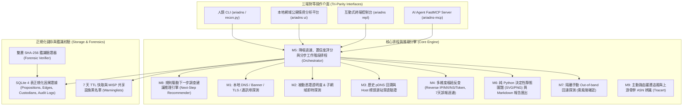

# Ariadns v1.0.1: Automated Domain OSINT & Pivoting Engine

> **版本命名邏輯 (Semantic Versioning)**：`vX.Y.Z`（當前定調：`v1.0.1`）
> - **X (Major)**：大型更新、底層資料庫或整體架構重大改動。
> - **Y (Minor)**：主要功能的調整、新增模組或介面增修。
> - **Z (Patch)**：Bugfix 缺陷修復、相容性優化。
>
> **Ariadns** 是一套輕量、模組化且「本地優先（Local-First）」的網域開源情報（OSINT）探測、因果證據鏈推理與法規調閱矩陣分析系統。
> 提供 **三端對等介面（Tri-Parity Interfaces）**：人類命令列（CLI）、互動式 REPL、本機高密度視覺工作台（Local Web UI），以及專為 AI Agent 設計的 Model Context Protocol（FastMCP）伺服器。
> 內建 4 張 SQLite 正規化因果證據表、7 天 MISP 誤報特徵懶加載同步、純 Python 靜態雙格式圖譜渲染（附密碼學浮水印），以及雙層位元級 SHA-256 完整性校驗工具。

---

## 系統核心架構 (System Architecture)



---

## 【中文版使用手冊】

## 一、安裝與環境準備

### 1. 系統需求
- Python 3.10+
- 支援作業系統：Windows 10/11、Linux (Ubuntu/Debian/CentOS)、macOS、WSL2

### 2. 套件安裝
```bash
git clone https://github.com/jontykuan/Ariadns.git
cd Ariadns

# 建立並啟動虛擬環境 (建議)
python -m venv .venv
# Windows (PowerShell):
.venv\Scripts\activate
# Linux / macOS:
source .venv/bin/activate

# 安裝套件與開發依賴
pip install -e .
```

### 3. 本地外部工具檢查（非強制，系統支援原生自動降級）
Ariadns 核心具備純 Python 原生解析能力。若本機安裝有 ProjectDiscovery 的 `subfinder`、`httpx` 或 `nmap`，系統將自動調用以獲得最高性能：
```bash
ariadns doctor
```
- 一鍵安裝腳本：
  - **Linux / macOS / WSL**: `bash scripts/install_tools.sh`
  - **Windows (PowerShell)**: `.\scripts\install_tools.ps1`

### 4. 設定檔初始化
```bash
ariadns init
```
此指令會從 `config.yaml.example` 複製產生 `config.yaml`（已列入 `.gitignore`，可填寫 VirusTotal 等選用之免費 API Key）。

---

## 二、人類使用說明書（Human Operator Manual）

Ariadns 提供 **一鍵全自動 CLI**、**分步工作階段 CLI**、**互動式 REPL** 與 **本地網域公開情資分析平台 (Web UI)**。

### 1. 一鍵全流程 CLI 模式

- **基礎掃描（L1 網域）**：
  ```bash
  ariadns run -d example.com --output-dir ./reports
  ```
  *(相容原始需求指令：`python recon.py -d example.com --no-portscan`)*

- **二級關聯深度掃描（L1 + 高信度 L2 遞迴）**：
  ```bash
  ariadns run -d example.com --depth 2 --output-dir ./reports
  ```

- **啟用通訊埠探測（針對非 CDN IP）**：
  ```bash
  ariadns run -d example.com
  # 預設跳過通訊埠掃描，不加 --no-portscan 或在配置中啟用即會掃描非 CDN 目標
  ```

### 2. 分步推進與鑑識驗證 CLI 指令集

- **分步推進工作階段（Stepwise Execution）**：
  不執行一次性掃描，每次僅單步執行特定模組，並將新發現之 Fact/Conclusion 合併入資料庫：
  ```bash
  ariadns step -d example.com -m m1
  ariadns step -d example.com -m m2
  ariadns step -d example.com -m m3
  ariadns step -d example.com -m m4 --target 1.2.3.4
  ```

- **取得下一步調查建議（Next-Step Inference）**：
  由推論引擎分析當前已知事實，列出下一步建議執行的模組與理由：
  ```bash
  ariadns recommend -d example.com
  ```

- **生成靜態證據圖譜與清單（Render Evidence Graph）**：
  主動執行畫圖（延遲渲染），可篩選包含節點：
  ```bash
  ariadns render-graph -d example.com --select F1,C1,F_ORIGIN,C_ORIGIN
  ```

- **檢視結構化命題與稽核日誌（Show Graph Propositions）**：
  ```bash
  ariadns show-graph -d example.com
  ```

- **檔案密碼學完整性驗證（Forensic Verification Tool）**：
  重新計算磁碟檔案與資料庫狀態雜湊，校驗產出物位元級正確性：
  ```bash
  ariadns verify --case-dir ./reports/example.com
  ```

- **手動同步 7 天 MISP 誤報特徵清單**：
  ```bash
  ariadns sync-lists --force
  ```

- **隔離手動 Out-of-band 回連探測（需明確風險確認）**：
  ```bash
  ariadns manual-oob -t https://target.com/preview -c https://attacker-listener.com/callback --ack-risk
  ```

- **主動路由躍遷追蹤與末跳機房探測（需明確風險確認）**：
  ```bash
  ariadns trace -d example.com --target 182.173.0.181 -H 20 -w 500 --tail-hops 3 --ack-risk
  ```

### 3. 本地網域公開情資分析平台（Local Web UI Platform）

包裝完整 CLI 能力的高密度視覺化操作介面（遵循 Impeccable 設計系統，零無效 AI 卡片）：
```bash
ariadns ui --port 8000 --open-browser
```
**工作台核心介面特性**：
- **頂部輕量狀態列**：即時顯示目前執行項目（Module）、標的（Target）、進度（Status）、已過秒數（Elapsed），以及 7 天 MISP 誤報清單同步狀態。
- **可視化操作指令卡片（CLI Command Cards）**：視覺化包裝 M1、M2、M3、M4 與 M7 指令，清楚說明使用目的、CLI 等價語法，並針對主動探測（M7）設置嚴格 OPSEC 風險確認閥門。
- **下一步調查建議面板（Next-Step Recommendations）**：由當前案件事實自動推導規則建議，一鍵「Apply & Run」分步執行。
- **證據節點篩選與主動畫圖（Deferred Rendering）**：分步執行時不即時運算圖檔以保證排版不崩潰；在主動點選「Generate Evidence Architecture Graph」前，使用者可勾選核心節點（預設已勾選核心成果，略過雜訊），生成不可動之純靜態圖檔與 SHA-256 戳記。
- **三大結構化鑑識矩陣**：
  - **Data Custodians Matrix**：依命題節點標的自動對應法規調閱機關（Registrar、CDN 業者、主機商、平台商）與可調閱紀錄清單。
  - **Session Audit Trail**：記錄每次分步執行步驟、時間戳、模組、標的、新增 Fact ID 與狀態 Hash。
  - **Cryptographic Manifest & Integrity**：呈現所有檔案雜湊，一鍵發起雙層 SHA-256 位元級驗證。

### 4. 互動式 REPL 控制台模式
```bash
ariadns repl
```
**REPL 內建常用指令**：
- `target <domain>`：指定當前調查的目標主網域。
- `scan [depth]`：對目標執行掃描（`depth 1` 或 `depth 2`）。
- `nodes`：列出該案件在圖譜中已記錄的所有節點。
- `l2`：列出經樞紐反查挖掘出的所有 L2 網域及其置信度評分。
- `expand <l2_domain>`：針對指定的高價值 L2 網域發起深度二次探測。
- `help` / `exit`：查看說明或退出。

### 5. 輸出報告說明
執行完畢後，預設於指定目錄（如 `./reports/`）產出標準鑑識檔案：
1. `<domain>_result.json`：符合 SRS Section 5.2 規範之純資料結構。
2. `<domain>_topology.json`：Cytoscape.js 與 D3.js 相容之節點/關聯邊拓撲圖檔案。
3. `<domain>_evidence.svg` / `<domain>_evidence.png`：純 Python 渲染之靜態非拖拽證據架構圖，附帶密碼學浮水印戳記。
4. `<domain>_manifest.json`：包含所有檔案雙層 SHA-256 摘要與狀態 Payload Hash 之鑑識清單。
5. `<domain>_report.md`：人類可讀之 Markdown 鑑識評估報告（包含個資、CDN 穿透、子網域、調閱機關矩陣與稽核日誌）。

---

## 三、AI Agent 驅動說明書（Agentic MCP Manual）

Ariadns 內建遵循 Model Context Protocol（MCP）標準的 stdio 伺服器，專為 Claude、Antigravity（agy）、Cursor、Cline 等 LLM Agent 設計。

### 1. Token 節流與正規化查詢原則（Summary-First & Zero-Recompute）
為防止大網域（數百個子網域與反查記錄）灌爆 Agent Context Window：
- **`osint_scan` 與 `osint_expand`**：所有原始資料全量存入本機 SQLite，**回傳給 Agent 的僅為高密度摘要（$\le 600$ tokens）**。
- **`osint_inspect`**：Agent 直接自 SQLite 4 張正規化證據表唯讀查詢，預設僅撈取繪製節點（$\le 500$ tokens），不再重複觸發耗時運算。

### 2. MCP 工具清單（Tools）

| 工具名稱 | 參數 | 功能說明與回傳範疇 |
| :--- | :--- | :--- |
| **`osint_scan`** | `domain: str`<br>`depth: int = 1`<br>`portscan: bool = False`<br>`mode: str = "full"` | 對指定網域發起全自動情報探測。回傳精簡 JSON 摘要（包含 CDN 狀態、真實 IP 推斷、管理員信箱、Top 10 關聯網域）。 |
| **`osint_inspect`** | `domain: str`<br>`query_type: str = "summary"`<br>`target_node: str = ""`<br>`sql_query: str = ""` | 零運算直接讀取 SQLite 4 張正規化證據表。支援 `"summary"`、`"neighbors"`、`"l2_candidates"`、`"evidence_chain"`、`"custodians"`，以及以 `mode=ro` 執行的唯讀 `"sql"`。預設僅撈取繪製節點，嚴格限制回傳 $\le 500$ Tokens。 |
| **`osint_run_step`** | `session_id: str`<br>`module_name: str`<br>`target: str`<br>`params: dict` | 分步執行指定模組（`m1`, `m2`, `m3`, `m4`, `m7`），將新事實增量合併入案件資料庫，並產生不可變稽核日誌（不自動畫圖）。 |
| **`osint_recommend_next`** | `session_id: str` | 依據當前已發掘之事實（如 CDN 存在、非 CDN IP 發現、未探測二級網域）推導具最高優先級之下一步調查建議。 |
| **`osint_render_graph`** | `session_id: str`<br>`output_dir: str = "./reports"`<br>`selected_prop_ids: list[str] = None` | 依據指定（或預設核心）命題節點集合，在磁碟上生成靜態 SVG/PNG 與 `_manifest.json`，並回傳 `payload_sha256`。 |
| **`osint_read_evidence_graph`** | `session_id: str`<br>`rendered_only: bool = True`<br>`limit: int = 20` | Agent 專用結構化因果 DAG 檢索小工具。直讀 `evidence_propositions` 與 `evidence_custodians`，防止讀取龐大圖像原始碼導致 Context 溢出。 |
| **`osint_verify_case`** | `case_dir: str` | 針對案卷資料夾執行雙層 SHA-256 驗證（包含各實體檔案 Hash 與 DAG 狀態 Payload Hash），驗證產出物未遭篡改。 |
| **`osint_sync_lists`** | `force: bool = False` | 同步或檢查 7 天 MISP 停車網域與共享郵箱清單，離線時自動回退本機快取與靜態黑名單。 |
| **`osint_expand`** | `parent_domain: str`<br>`l2_domain: str` | 對特定 L2 網域進行深度展開，並將節點合併至主圖譜。 |
| **`osint_report`** | `domain: str`<br>`output_dir: str = "./reports"` | 觸發在磁碟上產生 JSON、Topology、SVG/PNG 與 Markdown 報告，並回傳絕對路徑給 Agent。 |

### 3. Agent 環境註冊設定
在 Claude Desktop 或 Antigravity 設定檔中新增：
```json
{
  "mcpServers": {
    "ariadns": {
      "command": "python",
      "args": ["-m", "ariadns.interfaces.mcp_server"],
      "cwd": "d:/cykuan/geminiCLI/DNSA"
    }
  }
}
```

---

## 四、安全與防禦規範（OPSEC）

1. **API Key 遮罩**：所有控制台輸出與日誌紀錄一律對 API Key 實施 `abc***` 遮罩處理。
2. **7 天 TTL 熔斷保護**：相同查詢 7 天內全數命中 SQLite 快取，零重複發送外部請求。
3. **公共服務與停車網域過濾**：自動阻斷 Google Workspace、Microsoft Outlook、Cloudflare 等知名郵件/名稱伺服器，以及 MISP 停車網域反查，避免關聯膨脹。
4. **SQL 防護**：Agent 透過 `osint_inspect` 執行 SQL 時，底層強制以 SQLite `mode=ro` 唯讀連線執行，嚴禁變更資料庫。
5. **手動 OOB 隔離**：主動回連探測嚴禁進入自動化排程，必須透過 `manual-oob` 且附帶使用者風險授權標記方得執行。

---

## 【English User Manual】

## 1. Overview & Key Capabilities

**Ariadns v1.0.1** is a modular, high-density, **local-first** domain OSINT and forensic investigation framework. It provides **Tri-Parity Interfaces** across CLI, local Web UI, and FastMCP for AI agents.

### Versioning Logic (Semantic Versioning)
Ariadns adheres to Semantic Versioning (`vX.Y.Z`):
- **X (Major)**: Major architectural overhauls, database schema migrations, and breaking changes.
- **Y (Minor)**: New primary capabilities, module additions, or interface updates.
- **Z (Patch)**: Bug fixes, minor adjustments, and dependency patches.

### Core Highlights:
- **Tri-Interface Parity**: Every capability is accessible via CLI, FastMCP server, and Local Web UI.
- **Impeccable Design System**: Utilitarian, dark-mode (`#090d16` / `#0f172a`), high-contrast forensic workbench passing `impeccable detect` with **0 primary anti-patterns**.
- **Deferred Non-Draggable Graph Rendering**: Avoids layout collapse during stepwise runs. Deterministic SVG/PNG renderer creates static diagrams with cryptographic `payload_sha256` watermark stamps upon explicit request.
- **Normalized Evidence Schema**: Stores propositions, causal DAG edges, data custodian mappings, and immutable session audit logs in 4 dedicated SQLite tables.
- **7-Day Lazy Warninglist Sync**: Automatically synchronizes open-source MISP parking/shared infrastructure feeds with offline fallback.
- **Dual-Layer Forensic Verifier**: Recomputes artifact file hashes and DAG payload hashes bit-for-bit to prove chain-of-custody integrity.

---

## 2. Installation & Quick Start

### Prerequisites
- Python 3.10+
- OS: Linux, macOS, Windows 10/11, WSL2

### Setup
```bash
git clone https://github.com/jontykuan/Ariadns.git
cd Ariadns

python -m venv .venv
# On Windows PowerShell:
.venv\Scripts\activate
# On Linux/macOS:
source .venv/bin/activate

pip install -e .
```

### Dependency Check & Config Initialization
```bash
# Check optional external tools (subfinder, httpx, nmap)
ariadns doctor

# Initialize local config.yaml from example
ariadns init
```

---

## 3. Human Operator Manual

### 3.1 One-Shot Full Investigation CLI
```bash
# Level 1 investigation (Root domain)
ariadns run -d example.com --output-dir ./reports

# Level 2 deep pivoting (Expands high-confidence correlated domains)
ariadns run -d example.com --depth 2 --output-dir ./reports

# Enable port probe on unproxied non-CDN IPs
ariadns run -d example.com
```

### 3.2 Stepwise Case Execution & Verification CLI
Ariadns supports granular, stepwise case management without triggering full re-scans:
```bash
# Step 1: Probe local DNS and identity profile
ariadns step -d example.com -m m1

# Step 2: Enumerate subdomains via CT logs and wordlists
ariadns step -d example.com -m m2

# Step 3: Run origin detection and Host header collision
ariadns step -d example.com -m m3

# Step 4: Reverse pivot on discovered origin IP
ariadns step -d example.com -m m4 --target 198.51.100.24

# Infer rule-based next investigative actions
ariadns recommend -d example.com

# Inspect structured propositions and session audit log
ariadns show-graph -d example.com

# Render static SVG/PNG evidence DAG and manifest with selected nodes
ariadns render-graph -d example.com --select F1,C1,F_ORIGIN,C_ORIGIN

# Cryptographic forensic verification (dual-layer bit-for-bit check)
ariadns verify --case-dir ./reports/example.com

# Synchronize 7-day MISP false-positive warninglists
ariadns sync-lists --force

# Isolated active out-of-band callback probe (Requires risk acknowledgement)
ariadns manual-oob -t https://target.com/preview -c https://my-canary.com/probe --ack-risk
```

### 3.3 Local Web UI Forensic Workbench
Start the local forensic workbench web console:
```bash
ariadns ui --host 127.0.0.1 --port 8000 --open-browser
```
**Workbench Features**:
1. **Lightweight Status Bar**: Displays active module, target, stage progress, elapsed seconds, and 7-day warninglist sync status.
2. **Visual CLI Command Cards**: Interactive cards for M1, M2, M3, M4, and M7 with exact CLI command syntax, purpose descriptions, and an OPSEC risk checkbox for active probing.
3. **Next-Step Recommendations**: Rule-derived actions with 1-click `Apply & Run`.
4. **Proposition Node Filter**: Select or deselect discovered propositions before rendering to eliminate noise.
5. **Static Evidence DAG Viewport**: Displays static SVG/PNG diagrams with `payload_sha256` watermark stamp and format toggles.
6. **Tabular Forensic Matrices**:
   - **Data Custodians Matrix**: Legal disclosure authority mappings (Registrars, Cloudflare, AWS, etc.) and queryable log types.
   - **Session Audit Trail**: Stepwise logs with timestamps, modules, targets, added fact IDs, and state hashes.
   - **Forensic Manifest & Integrity**: Instant cryptographic verification badge.

### 3.4 Interactive REPL Console
```bash
ariadns repl
```
Commands: `target <domain>`, `scan [depth]`, `nodes`, `l2`, `expand <domain>`, `help`, `exit`.

### 3.5 Output Artifacts
Each case produces deterministic files in `./reports/<domain>/`:
- `<domain>_result.json`: Raw structured intelligence dataset.
- `<domain>_topology.json`: Cytoscape.js / D3.js compatible entity graph.
- `<domain>_evidence.svg`: Vector diagram of the causal evidence DAG with forensic watermark.
- `<domain>_evidence.png`: Rasterized diagram for reports and legal exhibits.
- `<domain>_manifest.json`: Dual-layer SHA-256 digests and payload state hash.
- `<domain>_report.md`: Comprehensive Markdown report with custodian disclosure matrices and audit logs.

---

## 4. AI Agent Manual (FastMCP Server)

Ariadns includes an MCP server over stdio for LLM agents (Claude, Antigravity, Cursor, Cline).

### 4.1 Token Economy & Context Preservation
- `osint_scan` returns compact summaries ($\le 600$ tokens) instead of dumping thousands of lines.
- `osint_read_evidence_graph` and `osint_inspect` default to `WHERE is_rendered = 1` and `LIMIT 20` ($\le 500$ tokens), reading precomputed SQLite tables without re-running scans.
- SQL queries execute strictly under `mode=ro` (read-only SQLite URI).

### 4.2 FastMCP Tool Catalog

| Tool Name | Parameters | Purpose & Return Scope |
| :--- | :--- | :--- |
| **`osint_scan`** | `domain: str`<br>`depth: int = 1`<br>`portscan: bool = False`<br>`mode: str = "full"` | Automated recon pipeline. Returns compact summary (CDN status, suspected origin IP, registrar, top L2 domains). |
| **`osint_inspect`** | `domain: str`<br>`query_type: str = "summary"`<br>`target_node: str = ""`<br>`sql_query: str = ""` | Zero-recompute queries against normalized tables. Supports `"summary"`, `"neighbors"`, `"l2_candidates"`, `"evidence_chain"`, `"custodians"`, and read-only `"sql"`. |
| **`osint_run_step`** | `session_id: str`<br>`module_name: str`<br>`target: str`<br>`params: dict` | Runs a single module stepwise (`m1`, `m2`, `m3`, `m4`, `m7`), merging facts into SQLite and logging audit entries without rendering images. |
| **`osint_recommend_next`** | `session_id: str` | Evaluates current propositions to emit prioritized next-step investigation recommendations. |
| **`osint_render_graph`** | `session_id: str`<br>`output_dir: str = "./reports"`<br>`selected_prop_ids: list[str] = None` | Generates static SVG/PNG evidence graph and `_manifest.json` on disk, returning `payload_sha256`. |
| **`osint_read_evidence_graph`** | `session_id: str`<br>`rendered_only: bool = True`<br>`limit: int = 20` | Agent-specific structured retrieval of causal propositions and custodians, preventing context overflow. |
| **`osint_verify_case`** | `case_dir: str` | Validates bit-for-bit cryptographic integrity of all case artifacts on disk against the state payload hash. |
| **`osint_sync_lists`** | `force: bool = False` | Synchronizes 7-day MISP warninglists into SQLite with offline native fallback. |
| **`osint_expand`** | `parent_domain: str`<br>`l2_domain: str` | Deep exploration of a high-value L2 domain, merging discoveries into the primary graph. |
| **`osint_report`** | `domain: str`<br>`output_dir: str = "./reports"` | Exports all forensic artifacts (JSON, SVG, PNG, Markdown) and returns absolute file paths. |

### 4.3 MCP Registration Configuration
Add the following to your agent's MCP configuration file (e.g., `claude_desktop_config.json`):
```json
{
  "mcpServers": {
    "ariadns": {
      "command": "python",
      "args": ["-m", "ariadns.interfaces.mcp_server"],
      "cwd": "d:/cykuan/geminiCLI/DNSA"
    }
  }
}
```

---

## 5. OPSEC & Defensive Safeguards

1. **API Key Redaction**: All CLI outputs, log streams, and UI payloads automatically mask credentials (`abc***`).
2. **7-Day TTL Cache Circuit Breaker**: Duplicate queries within 7 days hit local SQLite cache with 0 outbound network requests.
3. **Public Infrastructure Filtration**: Blacklists and 7-day MISP feeds prevent false-positive pivoting on multi-tenant mail and nameservers (Google, Microsoft, Cloudflare, etc.).
4. **Read-Only SQLite Boundary**: All agent-driven SQL queries run through SQLite URI `mode=ro` preventing database mutation.
5. **Isolated Manual OOB Probing**: Active callback injection is strictly excluded from automated workflows and requires explicit human risk acknowledgement (`--ack-risk`).

---

## 五、系統設計方案與推論引擎演進 (System Design & Causal Graph Theory)

Ariadns 突破傳統開源情報工具僅羅列平面資產清單的局限，採用嚴謹的**形式化因果命題 DAG（Causal Propositional Directed Acyclic Graph）**與**鑑識調閱單位自動映射機制**。

### 5.1 拓撲因果鏈與動態層級推導 (Topological Causal Derivation & Dynamic Rank)
- **非孤島約束（No Disconnected Islands）**：所有衍生事實節點（包括次要 IP/網域探測結果 `*_F1`、子網域 `F_SUB_*`、來源伺服器 `F_ORIGIN`、共構轉向資產 `F_PIVOT_*`、路由躍遷節點 `F_TRACE`）均強制溯源自提供該線索的上游節點。
- **動態層級公式**：
  $$\text{rank}(P) = \begin{cases} 0 & \text{若 } \text{premises}(P) = \emptyset \text{ (根網域直接觀測事實)} \\ 1 + \max_{u \in \text{premises}(P)} \text{rank}(u) & \text{若 } \text{premises}(P) \neq \emptyset \text{ (衍生推導節點)} \end{cases}$$
- **結構分層保證**：
  - **Rank 0**：調查標的之權威 DNS、RDAP 基礎觀測 (`F1`, `F2`)。
  - **Rank 1**：依根節點解析線索發起之衍生技術探測（如 IP 的 ASN 歸屬 `182_173_0_181_F1`、子網域枚舉 `F_SUB_1`、CDN 源站穿透 `F_ORIGIN`、目標末跳路由 `F_TRACE`）。
  - **Rank 2..N**：基於衍生線索進一步發起之橫向轉向 (`F_PIVOT_*`) 或具法律效力之可調閱結論 (`C1`, `C_ORIGIN`, `C_TRACE`)。

### 5.2 語意化三段式命題陳述 (Structured Premise-Method-Result Statements)
為確保調查結論具備法庭鑑識等級之可溯源性，所有節點 statement 嚴格採用**三段式結構化敘述**：
- **繁體中文 (`lang="zh"`)**：
  `【依據】<來源線索或父命題ID> 【方法】<使用的探測工具或比對技術> 【結果】<明確客觀的事實或結論內容>`
  - *範例 1*：`【依據】F1（解析紀錄包含 182.173.0.181） 【方法】Team Cymru BGP/ASN 與 HTTP 標頭探測 【結果】主機 IP 182.173.0.181 歸屬於 AS3462 (Chunghwa Telecom Co., Ltd.)，Server 標頭: nginx，CDN 代理: False`
  - *範例 2*：`【依據】F1（根網域 ofa177.net） 【方法】被動憑證透明度 (CT) 與 DNS 字典枚舉 【結果】子網域 api.ofa177.net 解析至 182.173.0.182（伺服器: nginx）`
- **英文 (`lang="en"`)**：
  `[Source] <upstream premise> [Method] <technique used> [Result] <observed evidence>`

### 5.3 圖面連線中點方法膠囊標籤 (Midpoint Edge Method Pills)
有向連線 $(u \to v)$ 的幾何中點自動計算座標 $(m_x, m_y)$，並繪製具深色底框與對應線條色彩的方法膠囊標籤（Edge Method Pill）：
- `A紀錄 ➔ ASN歸屬探測`：由主機 A/AAAA 解析記錄發起之 BGP/ASN 探測。
- `網域 ➔ 子網域枚舉`：由主網域透過被動 CT 日誌與字典發起之子網域搜集。
- `受保護網域 ➔ 來源碰撞探測`：透過歷史 pDNS 回溯與 Host 標頭/Favicon 碰撞發起之 CDN 穿透。
- `橫向共構轉向`：透過反向 IP、MX、NS 關聯延伸之共構標的。
- `路由躍遷追蹤`：透過 tracert 擷取目標前端最末跳實體接入機房。
- `事實推導 ➔ 調閱結論`：由技術事實推導出的可調閱實體結論。

### 5.4 四色語意節點框與三種因果連線樣式 (Semantic Visual Encoding & Legend)
- **4 色節點分類**：
  - **天藍色 (`#38bdf8`)**：直接觀測事實 (Direct Fact)
  - **琥珀橘 (`#f59e0b`)**：來源突破 / 路由追蹤 (Origin Breakthrough / Route Trace)
  - **靛紫色 (`#818cf8`)**：關聯轉向標的 (Correlated Pivot Domain L2)
  - **翠綠色 (`#10b981`)**：可調閱結論 (Actionable Custodian Conclusion)
- **3 種連線樣式**：
  - **灰色實線 (`#94a3b8`)**：直接演繹與所有權歸屬
  - **紫色虛線 (`#a855f7`, dasharray 6,4)**：橫向共構關聯轉向
  - **橘色點線 (`#f97316`, dasharray 2,4)**：主動探測、路由追蹤與回連驗證

---

## 六、工程規範與開發流程 (Engineering Standards & TDD Lifecycle)

Ariadns 遵循 Uncle Bob 的極限工程規範，所有功能皆透過嚴格的測試驅動開發與機械防護網落地。

### 6.1 嚴格測試驅動開發 (Uncle Bob TDD: Red-Green-Refactor)
1. **Red 階段**：先撰寫測試檔案（如 `tests/test_31_causal_derivation_and_edge_labels.py`），明確定義 Gherkin 驗收條件與輸入輸出值，執行確認必定紅燈（Fail on Assertion）。
2. **Green 階段**：在對應模組以最小程式碼（$\le 20$ LOC 粒度）實現功能，使測試綠燈通過。
3. **Refactor 階段**：重構優化圈複雜度（Cyclomatic Complexity $\le 10$），提取深模組介面，維持零無效代碼。

### 6.2 決定論式工作樹並行實作 (Git Worktree Task Graphs)
- 透過 `/mnb-slice` 將架構變更拆解為帶有明確阻擋邊（Blocking Edges）的有向無環任務圖（DAG）。
- 透過 `/mnb-g-worktree` 在獨立的 `.worktrees/<ticket-id>` 目錄下進行乾淨的隔離實作與驗收，各切片通過驗收門檻後才 Rebase 合併回整合分支，根絕工作區污染。

### 6.3 突變測試與零殘存突變體機制 (Mutation Testing)
- 測試套件具備**決定論式突變體擊殺防護（Deterministic Mutant Kill）**：
  - 邊界條件翻轉（如 `>` 改為 `>=`、`is_rendered` 預設值翻轉）必定使測試轉紅。
  - 任意步驟若發生靜態圖形非預期自動渲染（Autorender Mutant），測試直接拋出致命錯誤終止。
  - 狀態雜湊或審計日誌遭竄改時，雙層驗證器必須精確回報 `verified=False`。

### 6.4 前端視覺反模式嚴格檢驗 (Impeccable Design System)
- Web UI 範本檔案 [`workbench.html`](file:///d:/cykuan/geminiCLI/DNSA/src/ariadns/interfaces/templates/workbench.html) 強制納入自動化 CI 檢驗：
  ```bash
  npx impeccable detect "src/ariadns/interfaces/templates/workbench.html"
  ```
- **核心防護準則**：
  - 嚴格字體下限：所有 CSS 字體大小必須 $\ge 12\text{px}$，徹底禁止模糊微字。
  - 對比度合規：文字與底色對比度遵循 WCAG AA 標準（深色畫布 `#090d16` 配高亮度文字 `#f8fafc` 與淡灰 `#cbd5e1`）。
  - 單邊厚邊框禁止：禁用單側裝飾性厚邊框（如 `border-left: 3px solid ...`），全面採用一體化 `1px solid` 微邊框。
  - 零無效空白：各區塊佈局具備彈性伸展機制（`flex: 1`），證據清單支援多行自然換行。

---

## 七、版本更新指引與歷程 (Version Changelog & Upgrade Guide)

### 7.1 版本發行紀錄 (Changelog)

#### **v1.0.1 (當前版本 - 2026-11-10)**
- **優化證據推論呈現方案**：
  - **拓撲因果鏈全面縫合**：M1（次要標的）、M2（子網域）、M3（CDN 來源）、M4（共構轉向）、Trace（路由追蹤）皆自動掛載上游父命題，階層層級依 `rank = parent.rank + 1` 計算，消除斷裂孤島樹。
  - **結構化三段式敘述**：所有命題改以 `【依據】... 【方法】... 【結果】...`（英文 `[Source] ... [Method] ... [Result] ...`）輸出，直接點明推理邏輯。
  - **連線中點方法膠囊標籤**：SVG/PNG 在每條有向箭頭幾何中點自動繪製深色底框方法標籤（如 `A紀錄 ➔ ASN歸屬探測`、`網域 ➔ 子網域枚舉`、`受保護網域 ➔ 來源碰撞探測`、`橫向共構轉向`、`路由躍遷追蹤`、`事實推導 ➔ 調閱結論`）。
  - **節點標題方法標記**：節點上方標記模組代號（如 `[FACT] F1 | M1:DNS探測`、`[FACT] 182_173_0_181_F1 | M1:ASN/BGP`、`[CONCLUSION] C1 | 鑑識調閱`）。
  - **M9 Traceroute 路由躍遷整合**：支援 `-d`、`-h 20`、`-w 500`、保留末 3 跳與 Team Cymru 離線 ASN/PTR 情資富化，Web UI 具備彈出式參數微調與 OPSEC 確認視窗。
  - **Web UI 壓縮型按鈕卡**：將 M1~M4 壓縮為單行互動按鈕卡，釋出大量垂直空間予多行換行之證據節點清單；新增「自動執行」依序跑完 M1~M4。

#### **v1.0.0 (2026-11-10)**
- **初始正式發行版**：
  - 具備三端對等介面（CLI、REPL、Web UI、FastMCP）。
  - 4 張 SQLite 正規化因果證據表與 7 天 MISP 誤報特徵懶加載同步。
  - 純 Python 決定性靜態雙格式圖譜渲染（SVG/PNG）與雙層 SHA-256 密碼學浮水印驗證。
  - 完整的法規調閱機關矩陣（Data Custodians Matrix）映射機制。

---

### 7.2 跨版本升級指引 (Upgrade Instructions)

若您是從先前的版本升級至 `v1.0.1`，請在專案目錄下執行以下指令：

```bash
# 1. 取得最新程式碼與標籤
git fetch origin --tags --force
git checkout master
git pull origin master --tags --force

# 2. 重新以可編輯模式安裝 Python 模組
pip install -e .

# 3. 執行依賴與環境檢查
ariadns doctor

# 4. (選用) 執行全套回歸測試以驗證安裝完整性
pytest tests/ -v
```

若瀏覽器開啟 Web UI 時仍顯示舊版快取樣式，請於瀏覽器按下 `Ctrl + F5`（或 `Cmd + Shift + R`）強制重新整理以載入最新壓縮型卡片與對話方塊介面。

---

## 6. License
MIT License.

---

## 致謝 (Acknowledgments)
*Developed with the assistance of Google Antigravity.*
