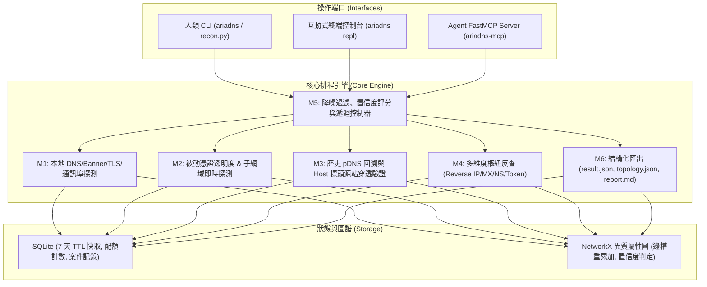

# Ariadns: Automated Domain OSINT & Pivoting Engine

> **Ariadns** 是一套輕量、模組化且「本地優先（Local-First）」的網域開源情報（OSINT）探測與關聯分析系統。
> 支援「人類操作端口（CLI / 互動式 REPL）」與「AI Agent 自主驅動端口（Model Context Protocol / FastMCP）」，內建 SQLite 7 天 TTL 快取與圖譜拓撲運算。

---

## 系統核心架構



---

## 一、安裝與環境準備

### 1. 系統需求
- Python 3.10+
- 支援環境：Windows 10/11、Linux (Ubuntu/Debian/CentOS)、macOS、WSL2

### 2. 套件安裝
```bash
git clone https://github.com/<your-username>/Ariadns.git
cd Ariadns

# 建立並啟動虛擬環境 (建議)
python -m venv .venv
# Windows:
.venv\Scripts\activate
# Linux/macOS:
source .venv/bin/activate

# 安裝套件及依賴
pip install -e .
```

### 3. 本地外部工具檢查（非強制，系統支援原生自動降級）
Ariadns 原生支援純 Python 解析。若本機安裝有 ProjectDiscovery 的 `subfinder`、`httpx` 或 `nmap`，系統將自動調用以獲得最高性能：
```bash
ariadns doctor
```
- 若要一鍵安裝外部工具：
  - **Linux / macOS / WSL**: 執行 `bash scripts/install_tools.sh`
  - **Windows (PowerShell)**: 執行 `.\scripts\install_tools.ps1`

### 4. 設定檔初始化
```bash
ariadns init
```
此指令會從 `config.yaml.example` 複製產生 `config.yaml`（已列入 `.gitignore`，可在此填寫 VirusTotal、AlienVault OTX 等免費 API Key）。

---

## 二、人類使用說明書（Human Operator Manual）

Ariadns 為人類使用者提供兩種操作模式：**一鍵全流程 CLI** 與 **互動式 REPL 控制台**。

### 1. 一鍵全流程 CLI 模式

- **基礎掃描（L1 網域）**：
  ```bash
  ariadns run -d example.com --output-dir ./reports
  ```
  *(相容原始需求指令：`python recon.py -d example.com --no-portscan`)*

- **二級關聯深度掃描（L1 + 高信度 L2 遞迴）**：
  ```bash
  ariadns run -d example.com --depth 2 --output-dir ./reports
  ```

- **啟用通訊埠探測（針對非 CDN IP）**：
  ```bash
  ariadns run -d example.com
  # 預設 --no-portscan 會跳過通訊埠掃描，不加該參數或在配置中啟用即會掃描非 CDN 目標
  ```

### 2. 互動式 REPL 控制台模式

適合分析人員「先看初步拓撲、再挑選特定二級資產手動深入擴展」：
```bash
ariadns repl
```
**REPL 內建常用指令**：
- `target <domain>`：指定當前調查的目標主網域（如 `target example.com`）。
- `scan [depth]`：對目標執行掃描（`depth 1` 或 `depth 2`）。
- `nodes`：列出該案件在圖譜中已記錄的所有節點（IP、子網域、Token、Email、MX 等）。
- `l2`：列出經樞紐反查挖掘出的所有 L2 網域及其置信度評分（`HIGH` / `MEDIUM` / `LOW`）。
- `expand <l2_domain>`：針對指定的高價值 L2 網域發起深度二次探測，並自動將新發現節點合併至主拓撲圖。
- `help` / `exit`：查看說明或退出。

### 3. 輸出報告說明
執行完畢後，預設於指定目錄（如 `./reports/`）產出三項標準檔案：
1. `<domain>_result.json`：符合 SRS Section 5.2 規範之純資料結構。
2. `<domain>_topology.json`：Cytoscape.js 與 D3.js 相容之節點/關聯邊拓撲圖檔案。
3. `<domain>_report.md`：人類可讀之 Markdown 評估報告（包含架設者個資、CDN 辨識、子網域清單與置信度評級）。

---

## 三、AI Agent 驅動說明書（Agentic MCP Manual）

Ariadns 內建遵循 Model Context Protocol（MCP）標準的 stdio 伺服器，專為 Claude、Antigravity（agy）、Cursor 等 LLM Agent 設計。

### 1. Token 節流設計原則（Summary-First Architecture）
為防止大網域（數百個子網域與反查記錄）灌爆 Agent Context Window：
- **`osint_scan` 與 `osint_expand`**：所有原始資料全量存入本機 SQLite，**回傳給 Agent 的僅為高密度摘要（$\le 600$ tokens）**。
- **`osint_inspect`**：Agent 僅在需要細節時，才依需求查詢「局部鄰居節點」、「特定 L2 候選」或執行「唯讀 SQL」。

### 2. MCP 工具清單（Tools）

| 工具名稱 | 參數 | 功能說明與回傳範疇 |
| :--- | :--- | :--- |
| **`osint_scan`** | `domain: str`<br>`mode: str = "full"`<br>`depth: int = 1`<br>`portscan: bool = False` | 對指定網域發起情報探測。回傳精簡 JSON 摘要（包含 CDN 狀態、真實 IP 推斷、管理員信箱、Top 10 關聯網域）。 |
| **`osint_inspect`** | `domain: str`<br>`query_type: str = "summary"`<br>`target_node: str = ""`<br>`sql_query: str = ""` | 深入檢視特定資料。支援：<br>- `"summary"`: 圖譜節點邊數摘要。<br>- `"neighbors"`: 查詢某節點的 1 跳鄰居。<br>- `"l2_candidates"`: 依置信度排序列出所有二級網域。<br>- `"sql"`: 執行安全的唯讀 `SELECT` 查詢。 |
| **`osint_expand`** | `parent_domain: str`<br>`l2_domain: str` | 當 Agent 在分析初步結果後，判斷特定 L2 網域具威脅或關聯價值時，下令對其進行深度展開，並將節點合併至主圖譜。 |
| **`osint_report`** | `domain: str`<br>`output_dir: str = "./reports"` | 觸發在磁碟上產生 JSON、Topology 與 Markdown 報告，並回傳絕對路徑給 Agent。 |

### 3. MCP 唯讀資源（Resources）
- `ariadns://sessions`：列出 SQLite 中所有歷史調查案件與時間戳。
- `ariadns://graph/{domain}/summary`：即時檢視目標網域的圖譜節點與邊數統計。

### 4. 如何在 Agent 環境中註冊 Ariadns MCP

#### 在 Claude Desktop / Antigravity / Cline 設定
將以下內容新增至你的 MCP 設定檔（例如 `claude_desktop_config.json` 或本機 IDE 的 MCP 設定中）：

```json
{
  "mcpServers": {
    "ariadns": {
      "command": "python",
      "args": [
        "-m",
        "ariadns.interfaces.mcp_server"
      ],
      "cwd": "d:/cykuan/geminiCLI/DNSA"
    }
  }
}
```
*(若在虛擬環境中，可將 `command` 替換為虛擬環境內的 Python 執行檔路徑)*

### 5. Agent 典型驅動範例情境
1. **Agent 發起初探**：
   `Call osint_scan(domain="target-company.com", depth=1)`
   Agent 取得摘要：發現目標使用 Cloudflare 防護，並自 SOA 記錄中取得 `sec-admin@target-company.com`。
2. **Agent 擴展二級樞紐**：
   `Call osint_inspect(domain="target-company.com", query_type="l2_candidates")`
   Agent 發現高信度關聯網域 `internal-portal.net`。
3. **Agent 深入穿透**：
   `Call osint_expand(parent_domain="target-company.com", l2_domain="internal-portal.net")`
   成功穿透並獲取真實源站 IP。
4. **Agent 產出總結報告**：
   `Call osint_report(domain="target-company.com")`
   回傳 Markdown 報告檔案路徑，向使用者交付調查結論。

---

## 四、安全與防禦規範（OPSEC）

1. **API Key 遮罩**：所有控制台輸出與日誌紀錄一律對 API Key 實施 `abc***` 遮罩處理。
2. **7 天 TTL 熔斷保護**：相同查詢 7 天內全數命中 SQLite 快取，零重複發送外部請求。
3. **公共服務過濾**：自動阻斷 Google Workspace、Microsoft Outlook、Cloudflare 等知名郵件/名稱伺服器的無效反查，避免關聯膨脹。
4. **SQL 防護**：Agent 透過 `osint_inspect` 執行 SQL 時，底層強制以 SQLite `mode=ro` 唯讀連線執行，嚴禁變更資料庫。

---

## 五、授權條款
MIT License.
